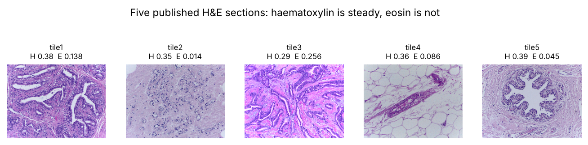

# What an H&E section tells you, and how much of it depends on the staining

**Live report:** https://bymankirat.github.io/HE-Histology-Image-Analysis/ · **Phase 1 (the workshop poster):** https://bymankirat.github.io/HE-Histology-Image-Analysis/phase1.html

In 2023 I cut and stained rat tissue by hand at a histology workshop in the Department of Zoology, Miranda House, University of Delhi.
The protocol we settled on fixed the haematoxylin at 35 seconds and the eosin at a single dip, and that choice was made by eye. This
repository is the computational phase: it separates the two dyes from the colour image, counts nuclei against a ground truth that is known
exactly, and then varies the staining on purpose to find out how much that one bench decision changes the answer.



## What I found

| Question | Result |
|---|---|
| Can the two dyes be separated reliably? | Yes, and exactly. Concentrations put into an image come back out of it to **1e-15**; on a real section the implementation agrees with scikit-image's own routine (**r = 1.0000** haematoxylin, 0.9942 eosin, 1.0000 DAB) |
| Can the dye colours be worked out from the image itself? | Yes. Macenko estimation recovers the vectors the image was built from to within **1.4°** (haematoxylin) and **1.7°** (eosin) |
| How accurate is the nuclei detector? | **F1 0.974** (95% CI 0.971–0.979), precision 0.994, recall 0.956 on held-out synthetic fields. Parameters were chosen on 3 development fields and reported on 6 others |
| Does the staining change what you measure? | With the tissue held fixed and the stain varied 0.4× to 2.0×: a threshold recomputed per image stays within **4.0%** of the true count; a fixed threshold loses **96%** of the nuclei at 0.4× (F1 falls to 0.08) |
| Does it happen outside the simulation? | In five published H&E sections the haematoxylin was reproducible (CV **11%**) but the eosin varied **18-fold** (CV 88%) |
| Does stain normalisation fix it? | Partly. It cuts the eosin spread to 5.7-fold (CV 48%) but widens the haematoxylin spread, and a threshold calibrated before normalisation finds nothing afterwards. It is not a substitute for standardising the stain |
| Does the detector invent nuclei? | No. On blank glass it returns **0** — but only after the negative control forced a floor on the threshold: Otsu alone, which always returns a value, found hundreds of "nuclei" in pure noise |

The conclusion is the one the workshop protocol already assumed, now with a number on it: pin the staining times down at the bench, and if
software is going to read the slides, use a method that re-derives its threshold from each image rather than a fixed cut-off.

## How it works

| Step | What | Tools |
|---|---|---|
| 1 | Download five published H&E tiles, cut them out of the figure strip, fingerprint every file | urllib, Pillow, MD5 |
| 2 | Colour deconvolution checked three ways: exact recovery on known mixtures, agreement with scikit-image, stain vectors estimated from the image alone | numpy, scikit-image |
| 3 | Synthetic fields with known nuclei; detector scored on fields it was not tuned on; blank-slide negative control | numpy, scikit-image, bootstrap CIs |
| 4 | The same fields re-stained from 0.4× to 2.0×, counted with an adaptive threshold, a fixed threshold, and a fixed threshold after normalisation | — |
| 5 | The five real sections measured and normalised | — |
| 6 | Figures and the interactive report | matplotlib, `docs/` |

```bash
pip install -r requirements.txt
python run_all.py          # every step, about 15 minutes
python tests/run_tests.py  # 27 tests, no pytest needed
python -m pytest -q        # the same tests, if you have pytest
```

The GitHub workflow runs the pipeline and the tests on every push and commits the results and logs back here.

### The pieces

- `pipeline/stains.py` — optical density, colour deconvolution, Macenko stain-vector estimation and normalisation, written from the
  equations so they can be checked against an independent implementation
- `pipeline/synthetic.py` — the forward model: nuclei of known position and size, the two stains applied through Beer-Lambert absorption,
  then uneven illumination, read noise and 8-bit quantisation
- `pipeline/nuclei.py` — segmentation (smooth, threshold, watershed) and the matching that scores it against truth
- `config.py` — every number that can be tuned

## Checks built in

- Deconvolution returns known concentrations to machine precision, and matches scikit-image on a real stained section
- Stain-vector estimation is refused on blank glass rather than guessed
- Parameters chosen on development fields, reported on held-out ones
- Blank slides must yield zero nuclei; the first version did not, which is why the threshold has a floor
- Each true nucleus can be matched once, so two detections on one nucleus count as one hit and one false positive
- Every image is reproducible from one seed, and every downloaded file is fingerprinted

## Limits

The ground truth is synthetic: it tests the detector and the arithmetic, not whether real nuclei look like the model's nuclei. The five real
tiles are crops of a published figure, so a nucleus is only a few pixels across and their counts are comparable with each other, not with a
full-resolution slide. They are also different tissues from different laboratories, so staining and biology vary together in them — which is
exactly why the controlled experiment is synthetic. Counting nuclei is not diagnosis.

## Sources

Real images: five H&E tiles from [StainTools](https://github.com/Peter554/StainTools) (MIT licence, Peter Byfield).
Reference stain vectors: Ruifrok AC, Johnston DA (2001), *Quantification of histochemical staining by color deconvolution*.
Stain-vector estimation and normalisation follow Macenko M et al. (2009), *A method for normalizing histology slides for quantitative
analysis*. Phase 1 was a departmental workshop poster; its authors are listed on
[the phase 1 page](https://bymankirat.github.io/HE-Histology-Image-Analysis/phase1.html).

Mankirat Singh · [Portfolio](https://bymankirat.github.io/myportfolio/) · [GitHub](https://github.com/bymankirat)
